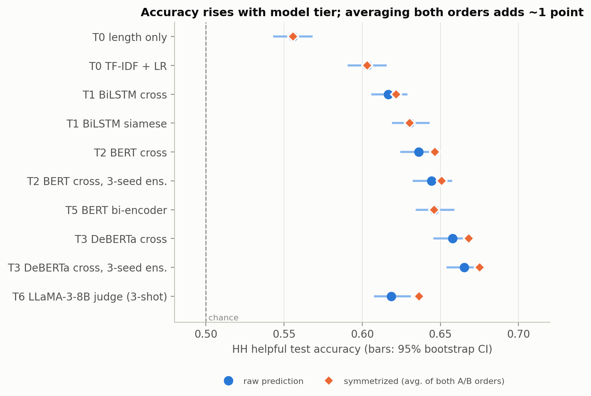
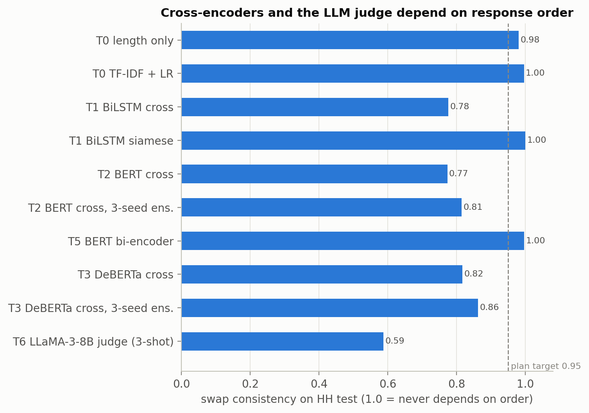
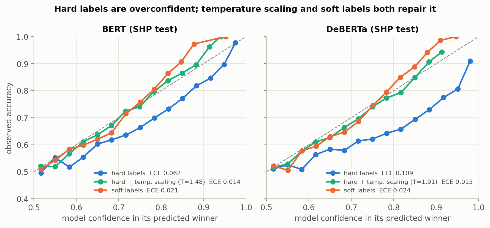

# Reliable Pairwise Preference Modeling for LLM Responses

Given a prompt and two candidate LLM responses, predict which one a human would prefer —
and measure how **reliable** that prediction is, not just how accurate.
We compare a cascade of models (TF-IDF → BiLSTM → BERT → DeBERTa-v3 → bi-encoder → LLaMA-3-8B judge)
on human preference data and test them for **position bias**, **length (verbosity) bias**,
**calibration**, **annotator disagreement** and **domain shift**.

Author: Ashish Sinha, IIT Bhilai · NLP / LLM alignment course project, 2026

**Report:** [`report/report.pdf`](report/report.pdf) (ACL format; LaTeX source in [`report/`](report/)).

---

## Key results

HH-RLHF helpful test set (6,194 pairs), trained on HH helpful. 95% bootstrap CIs in
[`results/tables/table1_hh.md`](results/tables/table1_hh.md); all significance tests (paired bootstrap,
2,000 resamples) in [`results/significance.csv`](results/significance.csv).

| Tier | Model | Params | Accuracy | Symmetrized acc. | ECE | Swap consistency | Harmless acc. |
|---|---|---|---|---|---|---|---|
| T0 | Length only | 1 | 0.556 | 0.556 | 0.020 | 0.98 | 0.422 |
| T0 | TF-IDF + logistic regression | 10K | 0.603 | 0.603 | 0.016 | 1.00 | 0.385 |
| T1 | BiLSTM, siamese | 11M | 0.630 | 0.630 | 0.012 | 1.00 | 0.361 |
| T2 | BERT-base cross-encoder | 110M | 0.636 | 0.646 | 0.022 | 0.77 | 0.352 |
| T5 | BERT-base bi-encoder | 110M | 0.646 | 0.646 | 0.023 | 1.00 | 0.343 |
| T3 | DeBERTa-v3-base cross-encoder | 184M | 0.658 | 0.668 | 0.064 | 0.82 | 0.346 |
| T3 | DeBERTa-v3-base, 3-seed ensemble | 3×184M | **0.665** | **0.675** | 0.039 | 0.86 | 0.338 |
| T6 | LLaMA-3-8B-Instruct judge, 3-shot (not fine-tuned) | 8B | 0.619 | 0.636 | 0.313 | 0.60 | **0.526**\* |

\*The judge's harmless accuracy is on a 1,000-pair random sample; all other cells use the full sets.
"Symmetrized" averages the predictions for both A/B orders.

**Findings**

1. **Small fine-tuned models beat the LLM judge (RQ1).** The DeBERTa ensemble is 4.7 points more accurate
   than LLaMA-3-8B (p < 0.001) and far better calibrated (ECE 0.04 vs 0.31). The judge strongly favours
   whichever response is shown first (position bias +0.31; 40% of its decisions flip when A/B are swapped).
2. **Position bias is real and is fixed at inference, not in training (RQ2).** Cross-encoders change their
   decision on 14–23% of pairs when A and B are swapped. Training with swapped copies does not fix this for
   transformers (BERT +0.8 points, n.s.); **averaging both orders** gives near-perfect consistency (0.999) and
   +1.0 point accuracy (p < 0.05). A bi-encoder is order-invariant by construction and at least as accurate as the
   cross-encoder (+1.0 point, p = 0.054, n.s.).
3. **Length bias survives every architecture.** Given two versions of the *same* answer, models pick the
   longer one 59–68% of the time ([Test B](results/tables/table5_test_b_length.csv)); shortening the better answer
   costs 3–7 points of accuracy.
4. **Soft labels make models agree with the human vote distribution (RQ3).** On SHP, training on vote shares
   instead of majority labels cuts ECE 3–4.5× and KL to human votes by 36–60% at every tier, with equal or better
   accuracy. Temperature scaling of a hard-label model matches soft labels on top-label calibration (ECE) but
   not on the vote distribution (KL), where soft labels win significantly.
5. **Model uncertainty does not detect human disagreement.** Neither MC dropout nor deep ensembles flag
   pairs where Reddit voters split (AUROC 0.50–0.54).
6. **Helpfulness and harmlessness preferences point in opposite directions.** Models trained on helpful data
   score 34–42% (below chance) on harmless prompts and vice versa; the LLM judge is the only model above chance there.
7. **The prompt barely matters.** A BERT that never sees the prompt is exactly as accurate (63.7% vs 63.6%).
8. **GPT-4 labels are not a substitute for human labels.** BERT trained on UltraFeedback (GPT-4 judged)
   reaches 55% on HH human labels vs 64% for human-label training, and is worse calibrated.

| Accuracy by tier | Position bias | Calibration (SHP) |
|---|---|---|
|  |  |  |

More figures: [soft vs hard KL](results/figures/fig4_rq3_kl_hard_vs_soft.png) ·
[length bias](results/figures/fig5_length_bias_test_b.png) · [domain shift](results/figures/fig6_domain_shift.png).
All tables: [`results/tables/`](results/tables/).

---

## Data

| Dataset | Use | Train / val / test |
|---|---|---|
| [Anthropic HH-RLHF](https://huggingface.co/datasets/Anthropic/hh-rlhf) (Bai et al., 2022), helpful subsets | main training + test | 111,311 / 5,997 / 6,194 |
| HH-RLHF harmless-base | domain-shift test; reverse-direction training | 38,741 / 1,995 / 3,993 |
| [Stanford SHP](https://huggingface.co/datasets/stanfordnlp/SHP) | soft labels: p(A) = score_A / (score_A + score_B) | 72,216 (quality-gated) / 6,936 / 18,406 (ungated) |
| [UltraFeedback](https://huggingface.co/datasets/HuggingFaceH4/ultrafeedback_binarized) (GPT-4 labels) | `[AI-Label]` ablation only | 51,344 / 2,000 / 1,715 |

- A/B order is randomized per pair (seed 42), so labels carry no position leak; validation sets are split by prompt.
- SHP quality gate (training only): |score_A − score_B| > 10, total > 20, 2·|p_A − 0.5| ≥ 0.2. The test set is ungated
  and contains 3,744 high-disagreement pairs (0.4 < p_A < 0.6).
- Token budget for every transformer: `[CLS] prompt (last 128 tokens) [SEP] A (first 190) [SEP] B (first 190) [SEP]`.
- **Content warning:** HH-RLHF contains offensive and upsetting text.

---

## Setup

Tested with Python 3.10, PyTorch 2.14 (CUDA 13), transformers 5.19 on one RTX 6000 Ada (48 GB).

```bash
python -m venv .venv && source .venv/bin/activate
pip install -r requirements.txt          # exact versions: requirements-lock.txt
export HF_HOME=$PWD/.hf_cache             # model weights cache (datasets are streamed, never cached)
hf auth login                             # only needed for the LLaMA-3 judge (gated model)
```

Experiments are tracked locally with MLflow (`mlflow.db`, no account needed):
`mlflow ui --backend-store-uri sqlite:///mlflow.db --port 5050`.

## Reproducing the results

Every command runs from the project root and writes `results/<run_name>/` (metrics, predictions) and
`checkpoints/<run_name>/` (best weights, fp16). Run names follow `<tier>_<model>_<labels>_<data>_seed<seed>`.

```bash
# 1. data (streams from Hugging Face, ~0.6 GB on disk)
python -m src.data.download --datasets hh shp uf
python -m src.data.preprocess --datasets hh shp hhh uf
python notebooks/01_eda.py                                     # EDA figures -> results/eda/

# 2. baselines (CPU / small GPU)
python -m src.models.length_baseline --dataset hh
python -m src.models.tfidf_baseline --dataset hh --features diff
python -m src.models.bilstm --dataset hh --mode siamese

# 3. transformers: any config + key=value overrides
python -m src.training.train --config configs/bert_base.yaml
python -m src.training.train --config configs/deberta_base.yaml dataset=shp label_type=soft
python -m src.training.train --config configs/bert_bi.yaml                      # bi-encoder
python -m src.training.train --config configs/bert_base.yaml swap_prob=0.5      # swap augmentation
python -m src.training.train --config configs/bert_base.yaml max_prompt=0       # no-prompt ablation

# 4. bias, uncertainty, LLM judge
python -m src.evaluation.bias_tests generate --n 500          # Test B data (uses Qwen2.5-7B-Instruct)
python -m src.evaluation.bias_tests evaluate t3_deberta_hard_hh_seed42
python -m src.calibration.mc_dropout t3_deberta_hard_hh_seed42
python -m src.calibration.ensemble t3_deberta_hard_hh_seed42 t3_deberta_hard_hh_seed1 t3_deberta_hard_hh_seed2
python -m src.models.llm_judge --model meta-llama/Meta-Llama-3-8B-Instruct --sets hh_val hh_test --max_n 0

# 5. post-hoc calibration, significance, tables and figures
python -m src.calibration.calibrate --all
python -m src.evaluation.significance
python notebooks/02_results.py                                  # -> results/tables, results/figures
```

The complete experiment schedule, exactly as it was run, is in [`scripts/`](scripts/)
(`run_week2.sh` … `run_week5.sh`, each a sequential queue); `scripts/status.sh` shows progress.

### Implementation notes

- **DeBERTa-v3 trains in fp32.** Under bf16 autocast its disentangled attention produced NaN predictions at scale;
  BERT is unaffected and uses bf16. DeBERTa therefore uses batch 16 × gradient accumulation 2.
- **`num_workers=0`** for all DataLoaders: forked workers deadlocked alongside MLflow's monitoring thread.
- Early stopping is on validation **loss**, not accuracy, which favours the best-calibrated checkpoint.
- Temperature scaling, isotonic regression and symmetrization are fitted on each model's own validation set.

## Demo

```bash
streamlit run demo/app.py --server.port 8501      # web UI
uvicorn demo.api:app --port 8000                  # REST API: POST /predict, GET /models
```

Enter a prompt and two responses (or load a random HH example). The demo scores both A/B orders, averages
them, applies temperature calibration, and reports the winner, the calibrated P(A), the order gap, and flags
for low confidence, order sensitivity, a long winner and truncated inputs. Three models are available:
DeBERTa (HH, most accurate), DeBERTa soft (SHP, best calibrated) and the BERT bi-encoder (order-invariant).
Set `DEMO_DEVICE=cpu` to run without a GPU.

## Repository layout

```
configs/        training configs (BERT, DeBERTa base/large, bi-encoder)
src/data/       streaming download, preprocessing and splits, PyTorch datasets and collators
src/models/     length / TF-IDF / BiLSTM baselines, cross-encoder, bi-encoder, LLM judge
src/training/   generic training loop (early stopping, MLflow), losses, train.py entry point
src/evaluation/ metrics (acc, AUC, Brier, ECE, KL, swap and length bias), Test B, significance tests
src/calibration/temperature scaling, isotonic, MC dropout, deep ensembles
notebooks/      01_eda.py, 02_results.py (VS Code cells; also run as scripts)
results/        metrics.json / calibration.json per run, tables/, figures/, significance.csv
demo/           Streamlit app and FastAPI endpoint
scripts/        experiment queues as they were run
```

## References

- Bai et al. (2022). *Training a Helpful and Harmless Assistant with Reinforcement Learning from Human Feedback.*
- Ethayarajh et al. (2022). *Understanding Dataset Difficulty with V-Usable Information* (Stanford Human Preferences).
- Cui et al. (2023). *UltraFeedback: Boosting Language Models with High-quality Feedback.*
- He et al. (2021). *DeBERTaV3: Improving DeBERTa using ELECTRA-Style Pre-Training with Gradient-Disentangled Embedding Sharing.*
- Guo et al. (2017). *On Calibration of Modern Neural Networks.*
- Lakshminarayanan et al. (2017). *Simple and Scalable Predictive Uncertainty Estimation using Deep Ensembles.*
- Gal & Ghahramani (2016). *Dropout as a Bayesian Approximation.*
- Zheng et al. (2023). *Judging LLM-as-a-Judge with MT-Bench and Chatbot Arena* (position and verbosity bias of LLM judges).
